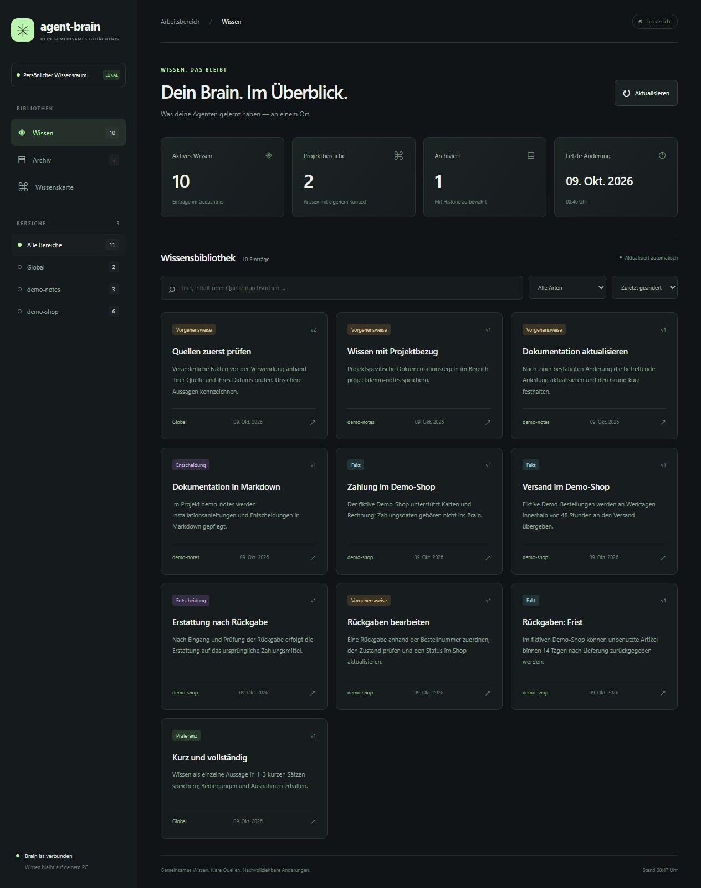
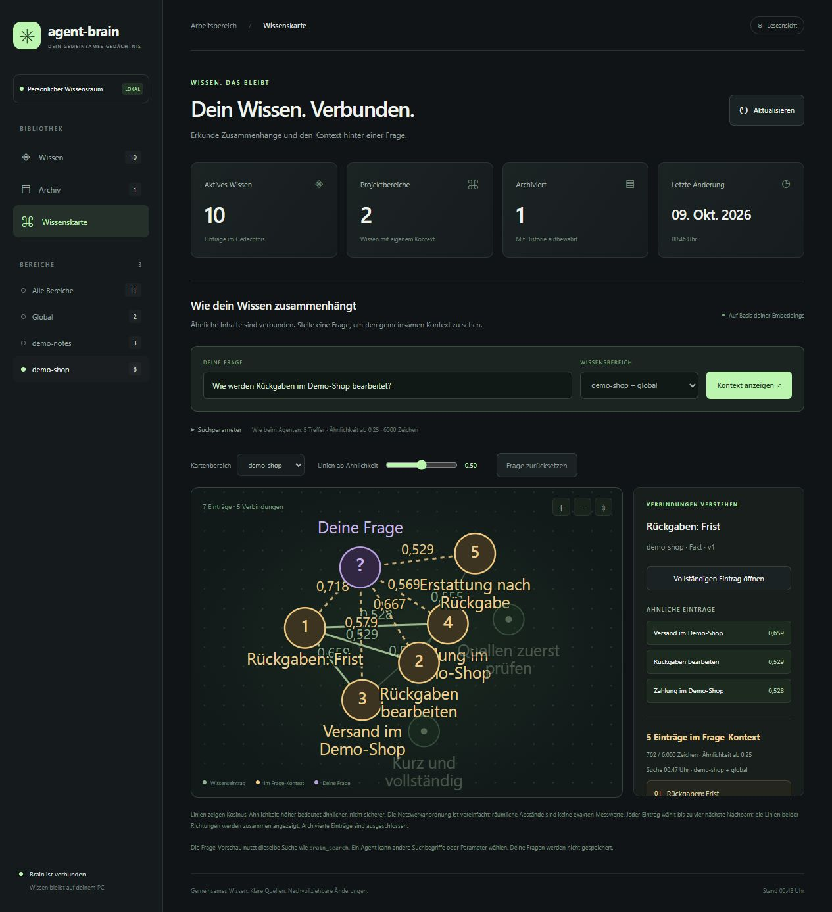
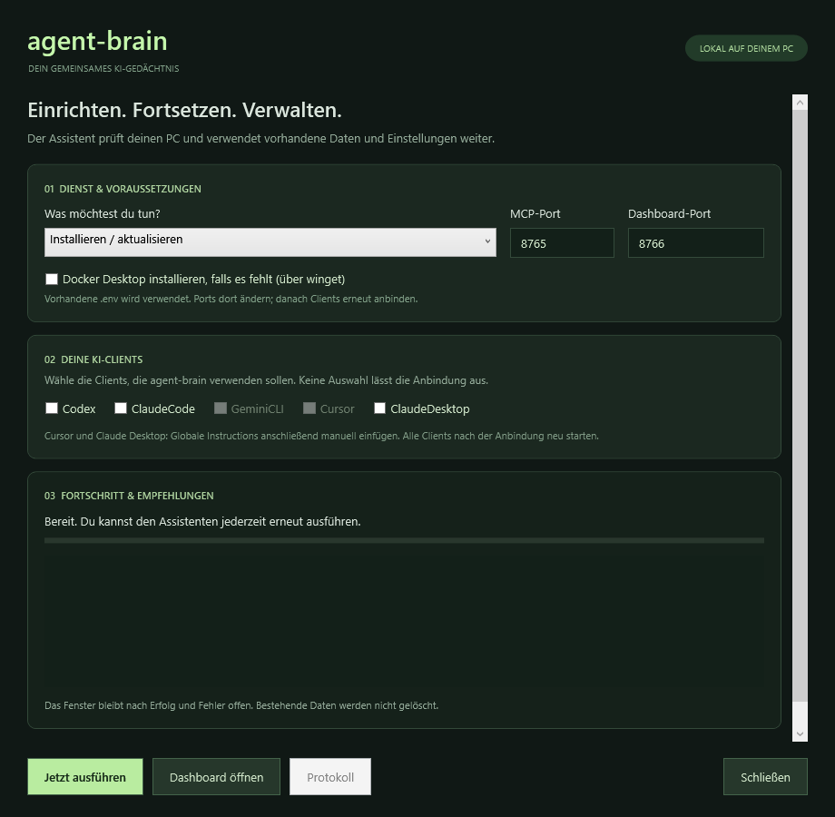

# agent-brain

**Ein gemeinsames Gedächtnis für deine KI-Agenten. Lokal auf deinem PC.**

[English](README.en.md) · [Download](https://github.com/Cobas91/agent-brain/releases/latest) · [Installation](docs/installation.md) · [Clients](docs/clients.md) · [Hilfe](docs/troubleshooting.md)

agent-brain speichert kurze Fakten, Entscheidungen und Vorgehensweisen in PostgreSQL mit pgvector. Deine Agenten suchen und pflegen dieses Wissen über MCP. Ollama erstellt die Embeddings lokal. Ein Dashboard zeigt Inhalte, Quellen, Versionen und ihre Zusammenhänge.



## In wenigen Schritten starten

1. [**agent-brain.zip herunterladen**](https://github.com/Cobas91/agent-brain/releases/latest/download/agent-brain.zip) und den **gesamten Ordner** dauerhaft entpacken, zum Beispiel nach `D:\Tools\agent-brain`. Alternativ: **Code → Download ZIP** oder `git clone https://github.com/Cobas91/agent-brain.git`.
2. **`Setup-agent-brain.cmd` doppelklicken.** Falls Docker Desktop fehlt, die entsprechende Option aktivieren. Bei Bedarf Docker-/WSL-Ersteinrichtung abschließen und den Assistenten erneut starten.
3. Erkannte KI-Clients auswählen und **„Jetzt ausführen“** anklicken. Nach Abschluss die Clients neu starten. Bei Cursor und Claude Desktop die angezeigten Hinweise zu globalen Anweisungen beachten.
4. [**Dashboard öffnen**](http://127.0.0.1:8766). In einem angebundenen Agenten fragen: „Suche im Brain nach vorhandenem Wissen. Merke dir für das Projekt demo: Dokumentation wird in Markdown gepflegt.“ Danach den Eintrag im Dashboard prüfen.

Voraussetzungen: ein von [Docker Desktop unterstütztes Windows](https://docs.docker.com/desktop/setup/install/windows-install/), 64 Bit, PowerShell 5.1 oder 7, lokale Linux-Container und Docker Compose ab 2.20. Für den Einstieg 8 GB RAM und mehrere GB freier Docker-Speicher einplanen. Eine GPU ist nicht erforderlich. Die erste Installation benötigt Internet für Images, Abhängigkeiten und das Modell. Die Oberfläche ist deutsch; die [englische Anleitung](README.en.md) erklärt denselben Ablauf.

Du musst kein Passwort eingeben. Der Installer erzeugt ein internes Datenbankpasswort in der geschützten lokalen `.env`. **Diese Datei behalten und nicht teilen.** Bei Wiederholungen bleiben Wissen, Modell, Einstellungen und andere Client-Anweisungen erhalten.

<details>
<summary>Installation über PowerShell</summary>

```powershell
cd D:\Tools\agent-brain
powershell -NoProfile -ExecutionPolicy Bypass -File .\Install-AgentBrain.ps1
# Grafische Oberfläche:
powershell -NoProfile -ExecutionPolicy Bypass -File .\Install-AgentBrain.ps1 -Gui
```

Der Konsoleninstaller wartet nach Erfolg oder Fehler auf eine Taste. Automatische Aufrufe verwenden `-NonInteractive -NoPause`. Docker wird nur mit `-InstallDocker` nachinstalliert.

</details>

## Was du bekommst

| Funktion | Verhalten |
|---|---|
| Gemeinsames Wissen | Global oder einem stabilen Projektnamen zugeordnet; alle Clients teilen denselben Speicher. |
| Kompakter Kontext | Üblicherweise 1–3 kurze Sätze je Eintrag. Suche standardmäßig mit bis zu 5 Treffern und 6000 Zeichen für Titel, Inhalt und Quelle. |
| Nachvollziehbare Pflege | Quelle, Datum, Versionen, Duplikaterkennung, Archiv und Wiederherstellung; Änderungen prüfen die erwartete Version. |
| Lokale Embeddings | `embeddinggemma` über Ollama, 768 Dimensionen, ohne Cloud-Embedding-API. |
| Dashboard | Bibliothek, Filter, Historie und interaktive Wissenskarte starten immer mit dem Stack. |
| Wiederholbarer Installer | Prüft Voraussetzungen, nutzt bestehende Ressourcen, begrenzt Wartezeiten und liefert Fehlercodes samt nächsten Schritten. |

Die [globalen Anweisungen](BRAIN-INSTRUCTIONS.md) fordern die Agenten auf, zuerst zu suchen und nützliches Wissen selbstständig zu pflegen. Der jeweilige Agent muss die Tools tatsächlich aufrufen; es gibt keine automatische Gesprächsüberwachung. MCP-Endpunkt: `http://127.0.0.1:8765/mcp`.

## Wissenskarte und gemeinsamer Frage-Kontext



Linien zeigen die Kosinusähnlichkeit gespeicherter Embeddings. Eine Frage markiert die Einträge, die `brain_search` mit den gewählten Parametern gemeinsam zurückgeben würde. Projektwissen schließt globale Einträge ein. Die Anordnung ist eine Orientierung, keine exakte Messung. Die Vorschau zeigt diese Abfrage; andere Agenten können andere Suchbegriffe verwenden. [Details zum Wissensmodell](docs/architecture.md).

## Der Installer



Aktionen: installieren/aktualisieren, starten, Clients anbinden, Diagnose, Funktionstest, sichern, Status und stoppen. Das Fenster bleibt geöffnet. PowerShell-Dateien verwenden UTF-8 mit BOM, damit Umlaute auch unter Windows PowerShell 5.1 korrekt angezeigt werden. Das Bild ist eine gerenderte Vorschau der tatsächlichen WPF-Oberfläche; die Dashboard-Screenshots zeigen ausschließlich Demodaten aus einer separaten Datenbank.

## Betrieb und Grenzen

```powershell
.\Install-AgentBrain.ps1 -Action Diagnose
.\Install-AgentBrain.ps1 -Action Configure -Agents Codex,ClaudeCode
.\Install-AgentBrain.ps1 -Action Backup
.\Install-AgentBrain.ps1 -Action Test
```

MCP und Dashboard sind an `127.0.0.1` gebunden, PostgreSQL und Ollama haben keine Hostports. Es gibt keine eigene Benutzeranmeldung. Projektbereiche sind Suchfilter, keine Zugriffsrechte. Cloudbasierte Agenten erhalten gelesene Treffer in ihrem Modellkontext; vollständig lokale Speicherung macht einen Cloud-Agenten nicht lokal. Cloud-MCP-Clients erreichen `localhost` auf deinem PC nicht direkt.

Der komfortable Installer ist für Windows ausgelegt. Die Docker-Dienste bestehen aus Linux-Containern; eine Anleitung für andere Betriebssysteme ist noch nicht getestet. **Nicht `docker compose down -v` verwenden:** Das löscht Wissen und Modelle. [Sicherungen, Updates und Fehlerbehebung](docs/troubleshooting.md).

## Dokumentation und Mitarbeit

- [Installation, Wiederanlauf und Optionen](docs/installation.md)
- [Client-Konfiguration und weitere MCP-Clients](docs/clients.md)
- [Architektur, Datenfelder und Tools](docs/architecture.md)
- [Fehlerbehebung, Sicherung und Wiederherstellung](docs/troubleshooting.md)
- [Tests und bisherige Validierung](TEST-REPORT.md)
- [Beiträge](CONTRIBUTING.md) · [Sicherheitsmeldungen](SECURITY.md) · [MIT-Lizenz](LICENSE)

agent-brain ist ein unabhängiges Projekt. Die Lizenz des Projekts ersetzt nicht die Bedingungen verwendeter Modelle, KI-Clients oder Docker Desktop.
