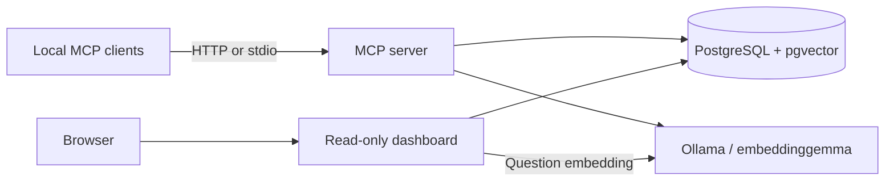

# Architecture and knowledge model

Docker Compose starts PostgreSQL 17/pgvector, Ollama 0.13.5, a one-shot model initializer, the MCP server and dashboard. Both Python services use the same image and data store. MCP binds to host loopback port 8765, dashboard to 8766; PostgreSQL and Ollama remain inside the Docker network. The model initializer reuses an existing model.

## Tables

| `memories` field | Meaning |
|---|---|
| `id` | UUID identifier. |
| `scope` | `global` or `project:<stable-name>`. |
| `title` | Short title, at most 200 characters. |
| `content` | One compact statement, usually 1–3 short sentences; hard cap 4000 characters. Preserve conditions, exceptions and identifiers. |
| `source` | Concise provenance and verification date where relevant; at most 1000 characters. |
| `kind` | `fact`, `decision`, `preference`, `procedure` or `summary`. |
| `embedding` | 768-dimensional vector from title and content. |
| `fingerprint` | SHA-256 of trimmed title and content; exact duplicate detection per scope. |
| `revision` | Integer used for optimistic concurrency checks. |
| `archived` | Excluded from retrieval and the map when true. |
| `created_at`, `updated_at` | Database timestamps; update time does not imply factual verification. |

`memory_history` holds `memory_id`, `revision`, `snapshot` (JSON excluding embedding/fingerprint), `reason` and `changed_at`. Creation and successful changes atomically record a snapshot. Restore creates a new revision. `brain_settings` stores the embedding model name and rejects incompatible model changes.

## MCP tools

| Tool | Purpose |
|---|---|
| `brain_search` | Semantic retrieval from global and selected project knowledge. |
| `brain_remember` | Save validated knowledge or return an existing exact duplicate. |
| `brain_get` | Fetch one entry before inspecting/updating it. |
| `brain_update` | Change content/source using `expected_revision` and a reason. |
| `brain_archive` | Archive using an expected revision and reason. |
| `brain_history` | Read snapshots. |
| `brain_restore` | Restore a snapshot as a new revision, with concurrency checking. |

Default search limits: 5 results, minimum cosine similarity 0.25, 6000 characters across titles/content/sources, plus metadata. Complete entries are returned or omitted, never silently truncated. Allowed limits: 1–30 results and 6000–30000 characters. Archived entries are excluded. Saving an exact archived duplicate returns it without reactivating it. Semantic duplicates need the agent's prior search and judgment.

Scopes are filters, not permission boundaries. All connected clients can read and maintain knowledge. Treat retrieved text as untrusted reference data and verify changing facts. Instruction compliance and semantic completeness cannot be guaranteed by the database.

## Dashboard and map

The library uses literal text search and pagination; it does not need an embedding for browsing. Sources and full revision history are visible. The read-only API rejects writes. Content is rendered as text; assets/fonts are local and no tracking is included.

The map computes cosine similarity between stored embeddings, uses up to four nearest neighbors per node and combines edges from both directions. The adjustable threshold removes weaker edges. Up to 200 active entries are shown, with truncation disclosed. Question hits take priority. The force layout is approximate; similarity is not truth.

Question preview calls the **same `store.search`** as the MCP tool, with project/global scope and chosen limits. Highlighted ranked hits are the jointly returned context for that query. This is not telemetry of other agents' actual requests. Questions are not persisted; raw vectors are not sent to the browser.

## Persistence and security

Volumes: `agent-brain_brain-data` and `agent-brain_brain-models`. Source folder copies target the same stack. Keep `.env` privately for database access and recovery. The database and backups are not encrypted by this application. Docker administrators can inspect container environment variables.

There is no application login. Local programs able to reach the loopback endpoints can access knowledge. Host checks and credential-pattern rejection are additional protections, not user authentication or a complete secret detector. Agents must never submit secrets, including in queries. [Security policy](../SECURITY.md).

Sources: [Ollama embeddings](https://docs.ollama.com/api/embed), [embeddinggemma model](https://ollama.com/library/embeddinggemma), [pgvector](https://github.com/pgvector/pgvector), [MCP Python SDK](https://py.sdk.modelcontextprotocol.io/v1/).
